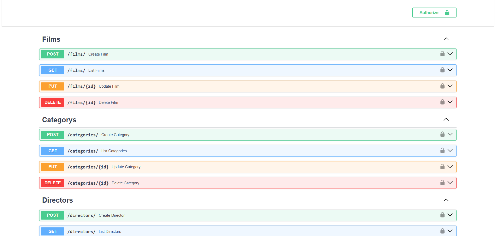

# Desafio Watt



## Instalação e Configuração

Para rodar este projeto, você precisará ter o **Docker** e o **Docker Compose** instalados na sua máquina.

### Pré-requisitos

- **Docker:** Certifique-se de que o Docker esteja instalado e em execução. Você pode baixá-lo e seguir as instruções de instalação em [docs.docker.com/get-docker/](https://docs.docker.com/get-docker/).
- **Docker Compose:** Geralmente, o Docker Compose já vem incluído na instalação do Docker. Verifique se ele está disponível.

---

### Como Rodar o Projeto

Siga estes passos para rodar o projeto localmente:

1. **Clone o repositório:**

   ```bash
   git clone https://github.com/BernardoSaullo/desafio-backend-watt.git
   cd desafio-backend-watt
   git checkout -b feature/bernardo-saullo origin/feature/bernardo-saullo
   ```

2. **Configurar variáveis de ambiente:**

   Antes de iniciar os serviços, crie um arquivo `.env` na raiz do projeto.
   Você pode usar o arquivo de exemplo `.env.example` como base:

   ```bash
   cp .env.example .env
   ```

   Em seguida, abra o `.env` e adicione suas credenciais e outras configurações necessárias.

   > ⚠️ É importante preencher corretamente as variáveis de ambiente para que a aplicação funcione.

3. **Inicie os serviços com Docker Compose:**

   ```bash
   docker-compose up --build
   ```

   Esse comando irá construir as imagens, baixar dependências e iniciar todos os containers.

4. **Acesse a aplicação:**

   * **Swagger:** [http://localhost:8000/docs#/](http://localhost:8000/docs#/)
   * **ReDoc:** [http://localhost:8000/redoc#/](http://localhost:8000/redoc#/)

---


## Como se Autenticar e Usar a API

Para interagir com a API, siga os passos abaixo:

1. Criar um usuário

Acesse o endpoint de cadastro (`POST /users`) e crie sua conta.

2. Realizar login

Use o endpoint de login (`POST /users/login`) com suas credenciais para obter um **token de acesso**.

3. Autorizar no Swagger ou Redoc

    - Copie o token retornado no login.
    - Clique no botão **Authorize** no Swagger ou Redoc.
    - Cole o token no campo correspondente e confirme.

> ✅ Após isso, você estará autenticado e poderá usar todos os endpoints protegidos da API.


---

## Stack utilizada

**Back-end:** FastAPI, SQLAlchemy

**Banco de Dados:** SQLite

---

## Funcionalidades Principais

### Autenticação e Usuários

- Cadastro de novos usuários no sistema
- Login com **e-mail e senha**
- Geração e validação de **token JWT** para acesso autenticado às rotas protegidas

### Gestão de Filmes

- Cadastro de filmes com informações como título, categoria, idioma e ano de lançamento
- Consulta de filmes com **filtros avançados** (título, categoria, idioma, ano de lançamento) e **paginação**
- Atualização dos dados de um filme existente
- Exclusão de filmes

### Gestão de Categorias

- Cadastro de categorias de filmes
- Consulta de categorias com **filtros por nome**
- Atualização dos dados de uma categoria existente
- Exclusão de categorias

### Gestão de Diretores

- Cadastro de diretores
- Consulta de diretores com **filtros por nome**
- Atualização dos dados de um diretor existente
- Exclusão de diretores

---

## Funcionalidades de Infraestrutura e Segurança

### Autenticação e Autorização

- Implementação de **JWT (JSON Web Token)** para autenticação segura dos usuários
- Proteção de endpoints sensíveis, exigindo **token válido** para acesso

### Hash de Senhas no banco de dados

- Utliza da biblioteca Bycript para armazenamento seguro de senhas no banco de dados

### CORS (Cross-Origin Resource Sharing)

- Configuração de CORS para permitir que apenas **origens autorizadas** consumam os endpoints da API

### Logs Estruturados

- Middleware para **registro detalhado de requisições e respostas**
- Configuração de **sobrescrita/rotação de logs**, evitando crescimento excessivo de arquivos

### Seeds Iniciais

- Inserção automática de **dados padrões** no banco (ex.: categorias, diretores, etc.), facilitando a inicialização do ambiente

### Paginação

- Implementação de **paginação em consultas**, garantindo melhor performance e escalabilidade em cenários com grandes volumes de dados

### Swagger (OpenAPI)

- Documentação automática e interativa da API
- Possibilidade de **testar endpoints diretamente no navegador**
- Configuração para **autenticação JWT no Swagger**, permitindo validar rotas protegidas

---
